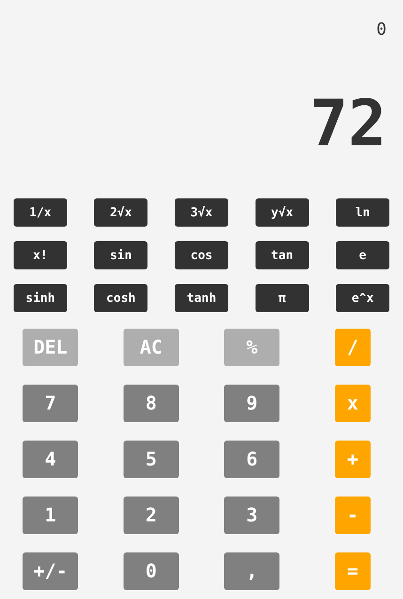

# calcolatrice_ispw

> 🚧 **Work in progress.** Il progetto è in sviluppo: molte funzioni non sono ancora implementate e il codice può cambiare in qualsiasi momento.

> ⚠️ **Disclaimer.** Questo è un esercizio personale svolto durante lo studio del corso. Può contenere errori, sia nel codice sia nelle scelte di progettazione. **Non è materiale ufficiale del corso** e non è stato verificato dal docente: non usarlo come riferimento o come soluzione corretta.

Calcolatrice con interfaccia grafica in **JavaFX**, realizzata come esercizio per il corso di
**Ingegneria del Software e Progettazione Web (ISPW)**, Università degli Studi di Roma Tor Vergata.

<p align="center">
  
</p>

## Stato attuale

| Funzione | Stato |
|---|---|
| Inserimento delle cifre 0-9 | ✅ funzionante |
| `1/x` | ✅ funzionante |
| Operazioni base (`+`, `-`, `x`, `/`, `=`) | ⏳ da implementare |
| Funzioni scientifiche (`sin`, `cos`, `ln`, `x!`, radici, ...) | ⏳ da implementare |
| `DEL`, `AC`, `%`, `+/-`, virgola | ⏳ da implementare |

I tasti non ancora implementati sono presenti nell'interfaccia ma non hanno ancora un comportamento associato.

## Requisiti

- Java 21
- Maven
- JavaFX 21 (scaricato automaticamente da Maven)

## Avvio

Da IntelliJ: esegui la classe `Launcher`.

> `Launcher` esiste perché, senza `module-info.java`, avviare direttamente una classe
> che estende `Application` dà l'errore *"JavaFX runtime components are missing"*.

Da terminale (`mvn clean javafx:run`) il progetto **non parte ancora**: vedi *Problemi noti*.

## Struttura

Il progetto prova ad applicare il pattern **BCE (Boundary – Control – Entity)**:

```
src/main/
├── java/
│   ├── Boundaries/
│   │   └── CalcBoundary      # controller grafico dell'FXML: gestisce i click e aggiorna la view
│   ├── Controllers/
│   │   └── CalcController    # logica applicativa
│   ├── DAO/
│   │   └── BtnDAO            # creazione delle entità a partire dal tasto premuto
│   ├── Entities/
│   │   ├── Button            # astrazione di un tasto
│   │   ├── NumBTN            # tasto numerico
│   │   └── OneOverX          # operazione 1/x
│   ├── Launcher              # punto d'ingresso
│   └── Main                  # Application JavaFX: carica la view
└── resources/
    └── main-view.fxml        # interfaccia (Scene Builder)
```

Flusso di un'operazione:

```
click → CalcBoundary → CalcController → BtnDAO / Entities → risultato → CalcBoundary aggiorna il display
```

## Problemi noti

- In `pom.xml` la `mainClass` del `javafx-maven-plugin` è ancora un segnaposto (`tuo.package.App`), quindi `mvn javafx:run` non funziona.
- I calcoli usano `float`: la precisione è limitata e il display mostra i numeri come `7.0`.
- Non c'è gestione degli errori: per esempio `1/x` con `0` restituisce `Infinity`.
- Il display del risultato mostra `72` come testo di esempio finché non si esegue un calcolo.
- L'interfaccia usa il font *Cartograph CF*: se non è installato, JavaFX usa un font di sistema e l'aspetto può essere diverso dall'immagine.
